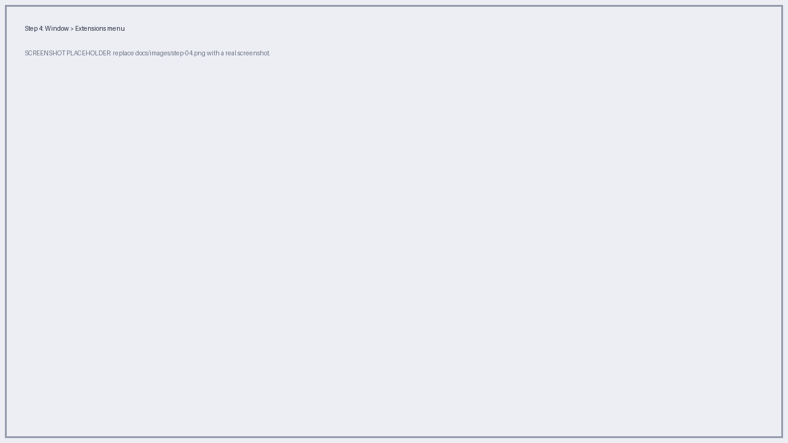
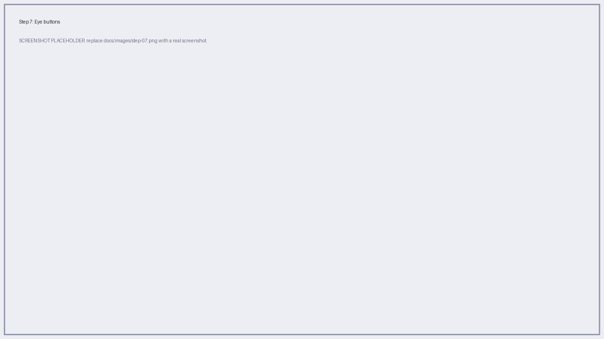
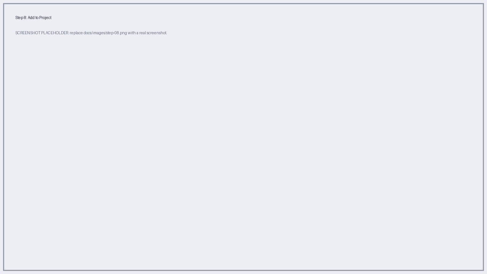
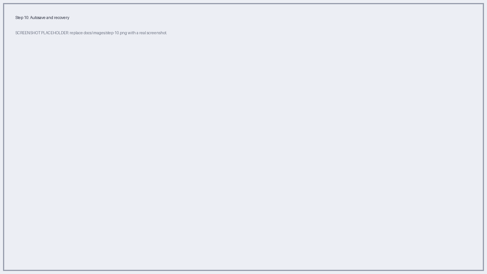
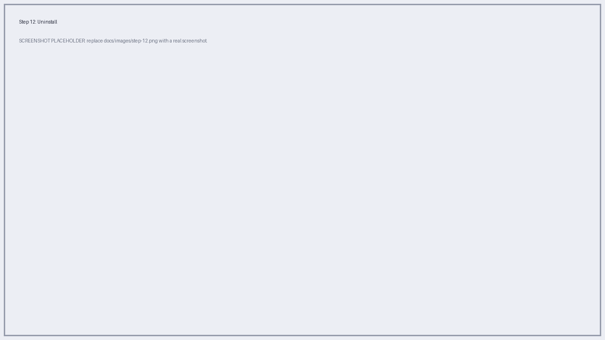

# Voxy EasyAnimator: install and first steps

This guide takes about ten minutes. You do not need to use a terminal or install Python.

## 1. Check the requirements {#requirements}

Check each item. If one is missing, read the note.

1. **After Effects.** Supported versions: {{AE_VERSIONS}}
2. **Windows 10 or Windows 11, 64-bit.**
3. **An NVIDIA graphics card.** Voxy is made for an NVIDIA RTX 3060 with 12 GB. Other NVIDIA cards work too, but big pictures may be slower.
   - No NVIDIA card? Voxy still works. It uses a slower mode and shows a note about it.
4. **About 3 GB of free disk space.**
5. **A recent NVIDIA driver.** Voxy's upscaler needs it. Update it on NVIDIA's website if you are not sure.

## 2. Download the installer {#download}

1. Open the official Voxy EasyAnimator download page.
2. Press the **Download** button.
3. Wait for the file `VoxyEasyAnimator-Setup.exe` to finish downloading.

Only download Voxy from the official page.

## 3. Run the installer {#run-installer}

1. **Close After Effects.** The installer cannot copy its files while After Effects is open.
2. Double-click `VoxyEasyAnimator-Setup.exe`.
3. If Windows shows a blue window that says "Windows protected your PC", read the note in [Windows shows a warning](#windows-warning). Then press **More info** and **Run anyway**.
4. **License page.** Read it. Choose **I accept the agreement**. Press **Next**.
5. **Folder page.** Keep the suggested folder. Press **Next**.
6. **After Effects versions page.** Keep the ticks on the versions you want. Press **Next**.
7. **Shortcuts page.** Tick the desktop shortcut if you want one. Press **Next**.
8. Press **Install**. Wait until it finishes.
9. **Checking your setup page.** Read each line:
   - **OK** means that part is ready.
   - **NOTE** means Voxy works, with a small limit. For example: "Update your NVIDIA driver to use the fast mode. The slow mode will still work."
   - **FIX** means something must be fixed first. The line says what to do.
10. Press **Finish**.

## 4. Open the panel in After Effects {#panel-opens}

1. Start After Effects.
2. Open a project, or make a new one.
3. Choose **Window** in the top menu.
4. Choose **Extensions**.
5. Choose **Voxy EasyAnimator**.

The panel opens. You can dock it like any other panel.

## 5. First run: the welcome and the sample {#first-run}

The first time you open the panel, it shows a short welcome with four steps:

1. Pick a layer.
2. Press **Make Layers**.
3. Hide any parts you do not want with the eye buttons.
4. Press **Add to Project**.

To see a result right away, press **Try the sample character**. The panel shows the sample cut into parts. The sample is only a preview. It does not change your project.

To check that everything works, press **Test setup**. Each line shows a green check when it is fine. If a line is not fine, it tells you what to do.

## 6. Make Layers on your own character {#make-layers}

1. Open a composition.
2. Click your character layer in the timeline. Select just one layer.
3. Look at the panel. It shows the layer's picture without you pressing anything.
4. Press **Make Layers**.
5. Wait. The panel cuts your character into parts. Nothing is added to your project yet.

Tips for the best result:

- Use a **single character**.
- Use **flat colors** and clean lines.
- Use a **clean, plain background**. A plain background gives the cleanest result.
- Keep the whole character in the picture, front view, arms away from the body.

The panel lists the parts under groups: Head, Face, Hair, Torso, Arms, Legs, and Hidden. Hidden holds the parts that were covered, such as an eye under a fringe. Voxy draws what was behind them.

If a part has nothing in it, Voxy leaves it out and tells you.

**Background Removal.** Turn this on before you press Make Layers. Voxy then also removes the background and redraws it as a separate layer.

## 7. Hide parts with the eye buttons {#eye-buttons}

Every part has an eye button. Every group has one too.

1. Press the eye next to a part to hide it.
2. Press it again to show it.
3. Press the eye next to the group name to hide or show the whole group.
   - A half-open eye means some parts of the group are hidden.

**The eyes only change the panel.** They do not change your After Effects project or its timeline. Hidden parts are not added in the next step.

When you press **Make Layers** again, all eyes open again.

**Hair.** Choose the **Hair** group in the list. You can then press **Cut hair into subdivisions**. Pick how many sections you want and how smooth the cuts are. Press **Combine** to make the hair one part again.

## 8. Add to Project {#add-to-project}

1. Check the parts. Hide the ones you do not want.
2. Press **Add to Project**.

Voxy adds every visible part to your composition. Each group becomes its own precomposition, named after the group. Inside, each part is its own layer. Each layer is masked so only its part shows. The pivot of each layer sits at a joint, so rotations turn where a joint would.

Your original layer is not changed.

**Add to Project is one undo step.** Choose **Edit > Undo** to undo it.

To remove what the last Add to Project made, press **Restore**. Restore never removes layers you made or renamed yourself.

In **Settings** you can choose to keep each group in one composition with folders instead of precomposition. Folders keep every part in your own composition. That makes it easier to link parts across groups.

## 9. Upscale 2x {#upscale}

Upscale makes the picture of the **selected layer** twice as big.

1. Click the layer in the timeline. It must be a still picture, such as a PNG or PSD layer.
2. Press **Upscale 2x**.
3. Wait. The panel shows the original and the bigger picture side by side.
4. Nothing in your project has changed yet. Choose one:
   - Press **Apply in Project** to use the bigger picture. The layer keeps its name, masks, position, and keyframes. The layer looks the same size as before.
   - Press **Discard** to throw the bigger picture away. Your project stays exactly as it was.

Apply in Project is one undo step. Voxy keeps a copy of the bigger picture in a folder called **Voxy Upscaled** next to your project.

If your graphics card runs out of memory, tick **Low memory mode** and try again.

## 10. Save, autosave, and recovery {#save}

**Save Project.** Press **Save Project**. Voxy saves without asking questions. It then shows the time it saved. If the project has no name yet, After Effects asks you where to save it.

**Autosave.** While the panel is open, Voxy saves a backup copy on a timer. The default is every 5 minutes. Change it in the panel, or set it to 0 to turn it off. Backups go in a folder called **Voxy Autosave** next to your project. Voxy keeps the newest ten. An autosave never replaces your own saved project. If an autosave cannot finish, your saved project is untouched and the panel tells you.

### After a crash {#crash-recovery}

1. Start After Effects again and open the Voxy panel.
2. If After Effects closed by accident, the panel says so and offers your newest backup.
3. Press **Open the backup** to get your work back. Your own project file is not changed.
4. Press **No thanks** if you do not want it.

## 11. Troubleshooting {#troubleshooting}

First press **Test setup** in the panel. It checks the most common problems and tells you what to do.

### The panel does not appear {#panel-does-not-appear}

1. Make sure you closed and restarted After Effects after installing.
2. Check **Window > Extensions** in After Effects. Voxy EasyAnimator should be in the list.
3. If it is not there, run the installer again. On the After Effects versions page, tick your version.
4. If you installed an early test build, run the installer again and keep the option that lets After Effects open the panel.

### The graphics card is not found {#gpu-not-detected}

1. Update your NVIDIA driver from NVIDIA's website. Restart your computer.
2. Open the panel and press **Test setup**.
3. If the card is still not found, Voxy keeps working in a slower mode. The panel shows a note while it does.

### The preview is blank {#blank-preview}

1. Click your layer in the timeline.
2. Make sure the layer is visible at the current time. Move the time marker onto the layer.
3. Press **Refresh picture** in the panel.
4. If the layer is a precomposition, open it and select a layer inside.

### No layer is selected {#no-layer}

1. Open the composition that holds your character.
2. Click your character layer once. Select just one layer.

### Voxy's helper program will not start {#service-wont-start}

1. Close the panel and open it again.
2. Press **Test setup**.
3. Restart After Effects.
4. Run the installer again to repair Voxy EasyAnimator.
5. Press **Open log file** in the panel. Send the file to support.

### Windows shows a warning {#windows-warning}

Windows may show "Windows protected your PC" for a new program. If you downloaded the installer from the official page, it is safe to continue.

1. Press **More info**.
2. Press **Run anyway**.

Once the installer is signed with a certificate, the warning goes away.

### Make Layers is slow {#slow-or-memory}

1. Check that the panel does not show the "slow mode" note. If it does, update your NVIDIA driver.
2. Close other programs that use the graphics card.
3. Use a smaller layer.
4. Cut one character at a time.

### Make Layers did not work {#make-layers-failed}

1. Use a picture with one character and a plain background.
2. Press **Make Layers** again.
3. If it keeps failing, press **Open log file** and send the file to support.

### Voxy did not find a character {#no-character}

1. Select the layer that shows your character.
2. Make sure the character is not hidden or transparent at the current time.

### The hair sections did not work {#hair-failed}

Your single Hair part is still there. Try fewer sections, or keep the single part.

### Some of Voxy's files are missing {#missing-files}

Run the installer again to repair Voxy EasyAnimator.

### A part is missing after Add to Project {#part-missing}

1. Check the eye buttons. Hidden parts are not added.
2. Check that the part is in the list. A part with nothing in it is left out, and the panel says so.
3. Press **Make Layers** again, then **Add to Project**.
4. If the composition changed size, press **Make Layers** again.

### The project did not save {#project-did-not-save}

1. Press **Save Project** again.
2. Check that the folder is not read-only and the disk is not full.
3. Use **File > Save As** to save to another place.
4. If the panel says automatic backups were turned off, use **File > Save As** to pick your project file again.

### Restore {#restore}

Restore only undoes the last Add to Project. Press it again to undo the one before.

### Upscale did not work {#upscale-problems}

1. Update your NVIDIA driver.
2. Tick **Low memory mode** and try again.
3. Use a smaller layer.

## 12. Uninstall {#uninstall}

1. Close After Effects.
2. Open **Settings > Apps** in Windows.
3. Choose **Voxy EasyAnimator**.
4. Press **Uninstall**.
5. The uninstaller asks if you also want to delete your Voxy settings and the backups of projects that were never saved. Choose **No** to keep them.

Backups that sit next to your own projects are never deleted.

