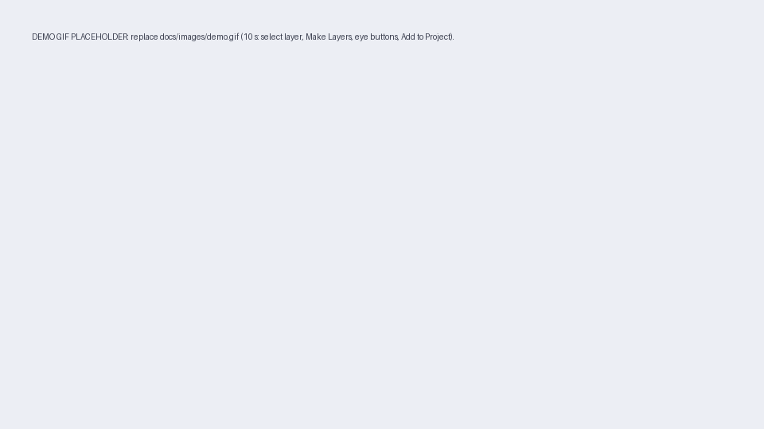

# Voxy EasyAnimator

**Turn a flat anime character into layers you can animate, inside After Effects.**

Pick a character layer. Press **Make Layers**. Voxy cuts it into head, face, hair, torso, arms, and legs. It even draws the parts that were hidden, like an eye under a fringe. Hide the parts you do not want, then press **Add to Project**. Each part becomes its own masked layer, with its pivot at the joint, ready to rotate.

## What you get

- **Make Layers.** A clean cut into parts, grouped as Head, Face, Hair, Torso, Arms, Legs, and Hidden.
- **Preview first.** Nothing is added to your project until you press Add to Project.
- **Eye buttons.** Hide any part or group. Hidden parts are not added.
- **Joints in the right place.** Rotations pivot at the shoulders, elbows, wrists, hips, knees, and ankles.
- **Hair sections.** Cut the hair into sections that share a root pivot, or combine them back.
- **Background Removal.** Take the character out and redraw the background.
- **Upscale 2x.** Make a layer's picture twice as big. See it first, then apply or discard.
- **Safe.** One undo step for each change. Restore removes what the last Add to Project made. Autosave keeps backup copies, and Voxy offers them after a crash.
- **Private.** Everything runs on your own computer. Your pictures are never sent anywhere.

## Requirements

- After Effects: {{AE_VERSIONS}}
- Windows 10 or 11, 64-bit
- An NVIDIA graphics card (made for the RTX 3060 with 12 GB). Without one, Voxy still works, only slower.
- About 3 GB of free disk space

## Download and install

[**Download Voxy EasyAnimator**](DOWNLOAD_URL_TO_BE_SET)

Then follow the [install guide](INSTALL.md). It takes about ten minutes, and you do not need a terminal.

## Questions

See **Troubleshooting** in the install guide, or press **Help** in the panel.
